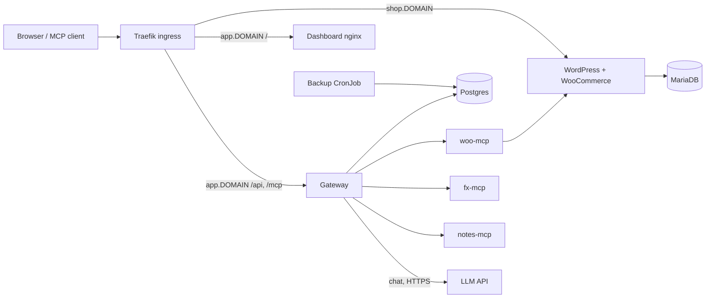

# Design

How the system fits together. Reasons live in the ADRs (`docs/decisions/`); risks live in `docs/THREAT_MODEL.md`. This note links to them instead of repeating them.

## 1. Architecture

Everything runs in namespace `urumi`. Only Traefik is reachable from outside. The namespace denies ingress by default and each workload has its own allow rule (ADR 019).

| Component | Owns |
|---|---|
| Traefik (k3s built-in) | TLS termination, host/path routing, optional http-to-https redirect |
| Dashboard | React UI served by nginx at `/` on `app.<domain>`; no state of its own (ADR 012, 016) |
| Gateway | `/mcp` (aggregated MCP server), `/api` (dashboard API), auth, roles, tool rules, rate limits, audit, chat agent, upstream connections |
| Postgres (StatefulSet, gateway chart) | users, sessions, API key hashes, upstream servers with encrypted credentials, tool rules, audit log, chat usage |
| woo-mcp | The five Woo tools over the Woo REST API; ClusterIP only, bearer token required (ADR 021) |
| WordPress + MariaDB | The store, with PVCs; WordPress is the storefront on `shop.<domain>` |
| fx-mcp, notes-mcp | The second and third upstreams (ADR 010, 011) |
| LLM API | Any OpenAI-compatible endpoint, called only by the gateway's chat agent (ADR 017) |
| Backup CronJob | Nightly `pg_dump` of the gateway database to its own PVC (ADR 025) |

## 2. Aggregation and routing

- **Namespacing.** Every upstream tool is exposed as `<slug>__<tool>`. The slug is unique, at most 20 characters, and cannot contain `__`, so the first `__` always ends the slug (ADR 007, `src/tool-names.ts`). An upstream tool whose prefixed name fails the client name pattern is skipped and logged.
- **List merging.** `UpstreamManager` keeps one MCP client per enabled upstream. `tools()` merges the tools of the connected ones. Disabled or unreachable servers contribute nothing. Per-upstream listing is capped at 20 pages and 500 tools.
- **list_changed.** The manager emits `toolsChanged` only when the combined set really differs (connect, disconnect, upstream `list_changed`, disable, a tool-rule change). The `/mcp` endpoint answers it by sending `notifications/tools/list_changed` to every open session (`src/app.ts`, `src/mcp-endpoint.ts`).
- **Finding the upstream.** `tools/call` carries `slug__tool`. `splitName` cuts at the first `__`; the gateway checks the caller's tool rules, then `UpstreamManager.callTool(slug, tool, args)` looks the slug up in its in-memory map and calls that upstream's client. Unknown, disabled and unreachable servers each give a distinct error naming the server.
- **Sessions.** `/mcp` is stateful: one MCP `Server` + transport per session in memory, closed by `DELETE /mcp` or after 30 minutes idle. A session is bound to the key that opened it. Because sessions and upstream connections live in memory, the gateway is one replica with strategy Recreate (ADR 006, 009).
- **Chat** calls the same `Gateway.callTool(user, name, args, "chat")` as `/mcp`, so routing, rules, timeouts and audit are one code path (ADR 017).

## 3. Auth and roles

- **Dashboard login:** email and password; the session is a random token in an HttpOnly, SameSite=Strict cookie, stored only as a SHA-256 hash (`Secure` when `COOKIE_SECURE=true`). POST/PATCH accept JSON only, which is the CSRF defence (ADR 008).
- **MCP clients:** an API key (`umk_` prefix), stored hashed, shown once, checked on every request so revoking works inside an open session. A member creates keys for themselves; an admin can list and revoke all (ADR 006, 014).
- **Upstream credentials** are encrypted at rest (AES-256-GCM, key from a Secret) and decrypted only when connecting. Client keys are never sent upstream (ADR 009, 023).
- **Roles:** `admin` and `member`, enforced server-side on every route, with the role read from the database per request. Admins manage servers, members, rules and see all audit rows; members see their own (ADR 014, 015).
- **Tool rules:** table `tool_rules`, one admin-only flag per tool, default-open. A restricted tool is hidden from members' `tools/list` and refused on call, in `/mcp` and chat alike. woo's two write tools are admin-only by default (ADR 022).
- Risks (shared upstream credentials, malicious tool descriptions, member vs member): see `docs/THREAT_MODEL.md`.

## 4. Failure handling

| Case | Behaviour |
|---|---|
| Slow upstream call | 15 s default (`CALL_TIMEOUT_MS`); the caller gets an error naming the server (`src/upstreams.ts`) |
| Unreachable upstream | Marked Unreachable and dropped from the list; other servers keep working. Calls to it fail fast with an error naming it |
| Health | A ping every 5 s (3 s ping timeout, 5 s connect timeout); a failing server reconnects on the next tick and tools are re-listed on reconnect |
| Oversized result | A tool result over `MAX_TOOL_RESULT_BYTES` (1 MB default) becomes an error result plus an audit row. It is checked after the body is buffered, so it is not a memory bound (see Future work) |
| Audit | Written in a `finally` block, best-effort: a failed write is logged and never fails the tool call (ADR 009, 015) |
| Readiness | `/healthz` is liveness; `/readyz` checks Postgres only, so an upstream outage never removes the gateway from its Service (ADR 009) |
| Postgres connection drops | The pool has an error listener, so a killed idle connection does not crash the pod |
| Shutdown | In-flight requests get up to 10 s, then connections are closed; grace period 15 s (ADR 009) |
| Backups | Nightly CronJob at 02:17 UTC, 7 days kept on a separate PVC; `make backup-pull` copies a dump off the node; `make restore-check` takes a fresh dump, restores it into a scratch database and compares table counts (ADR 025). Not encrypted, no WAL archiving, up to a day of data can be lost |

## 5. Local vs prod

| | Local (k3d) | Prod (k3s on an Azure VM) |
|---|---|---|
| Cluster | k3d cluster `urumi`, same k3s, Traefik, local-path and NetworkPolicy (ADR 001) | Single-node k3s; `ENV=prod` selects the `urumi-vps` kube context through an SSH tunnel (ADR 024) |
| Domain | `*.localtest.me` | `20.197.63.44.sslip.io` (`global.domain`, one line) |
| TLS | none, plain http | cert-manager (own Helm release) with the `letsencrypt-prod` ClusterIssuer, HTTP-01 through Traefik |
| Images | `make images` imports into k3d | Built locally and side-loaded with `docker save` over ssh, tags already on the node are skipped; no registry (ADR 024) |
| Secrets | created by `scripts/secrets.sh` (ADR 002) | same script; the LLM key goes in Secret `llm-api` |

`deploy/values-prod.yaml` changes exactly this (read from the file):
- `global.domain` set to the VPS hostname, `global.storageClass: local-path`.
- `global.ingress`: class `traefik`, `tls: true` (https URLs, ingress tls blocks, `COOKIE_SECURE=true`), `clusterIssuer: letsencrypt-prod`, `redirectHttps: true`.
- `certManager.clusterIssuers: true` renders the ClusterIssuers (k3d has no such CRD).
- `store.wordpress.environmentType: production`, with a mu-plugin so Application Passwords work over in-cluster HTTP.
- `gateway.llm`: Groq base URL and model.

`make lint` fails unless prod renders `COOKIE_SECURE "true"`.

## 6. Future work

Known gaps, in rough order of value. None blocks the required flows.

- **Admin one-time password reset link.** Today an admin cannot reset a member's password; a link like the invite link (hashed, single-use, expiring) would reuse the invite code path (ADR 014).
- **Disabled-login hint on the Members page.** A disabled user's login gives the same generic 401 as a wrong password (ADR 008); the admin sees no cue that the account is disabled.
- **Agent system-prompt line against guessed facts.** Tell the model to say when a tool result lacks a fact instead of inventing it (`src/chat/prompt.ts`, ADR 018).
- **Audit rejected `/mcp` requests.** Requests refused with 429 or 401 are not audited today; only tool calls are.
- **Byte-counting cap in `limitedFetch`.** `MAX_TOOL_RESULT_BYTES` is checked after buffering, so a hostile upstream can still make the gateway buffer what it sends within the call timeout; the 256Mi memory limit is the only bound (THREAT_MODEL, "Upstream pagination and size caps").
- **Default-closed tool rules.** A tool with no rule is open to members, so a new server's tools are usable until an admin marks them (ADR 022 accepts this; a per-server "new tools admin-only" default would close it).
- **Shared counters for more than one replica.** Rate-limit buckets, sessions and upstream connections are in memory (ADR 006, 020); scaling out needs Postgres or Redis counters and sticky or shared sessions.

### Skipped bonuses

Names from `docs/REQUIREMENTS.md`.
- **Multi-store:** one store is enough for the assignment; supporting more would mean namespaces per store and a provisioner, which is a project of its own.
- **OAuth for MCP clients:** API keys cover every client we use; OAuth is a separate authorization server's worth of work.
- **Hosted MCP servers (the gateway running upstreams for users):** upstreams are registered by URL and run in the cluster; running arbitrary user code is a security surface we chose not to open.
- **Many-tools search:** three upstreams expose a small tool set, so the flat list is fine; a search tool matters only at hundreds of tools (listing is already capped at 500 per upstream).
- **Horizontal scaling:** skipped; sessions, rate-limit buckets and upstream connections are in memory, so the gateway stays one replica (ADR 006).

### Partial

- **Observability:** exists: `/healthz` and `/readyz`, the audit log, one plain-text log line per chat request (not structured JSON). Missing: metrics, and alerting of any kind, including certificate expiry.

### Done, not skipped

- **Upgrades/rollback:** `helm rollback` rev4 to rev5 was rehearsed on the VPS; image tags are git tree hashes (README "Upgrade and rollback", ADR 024).

What was attempted instead of the skipped bonuses is in the README "Stand-out items" list.
